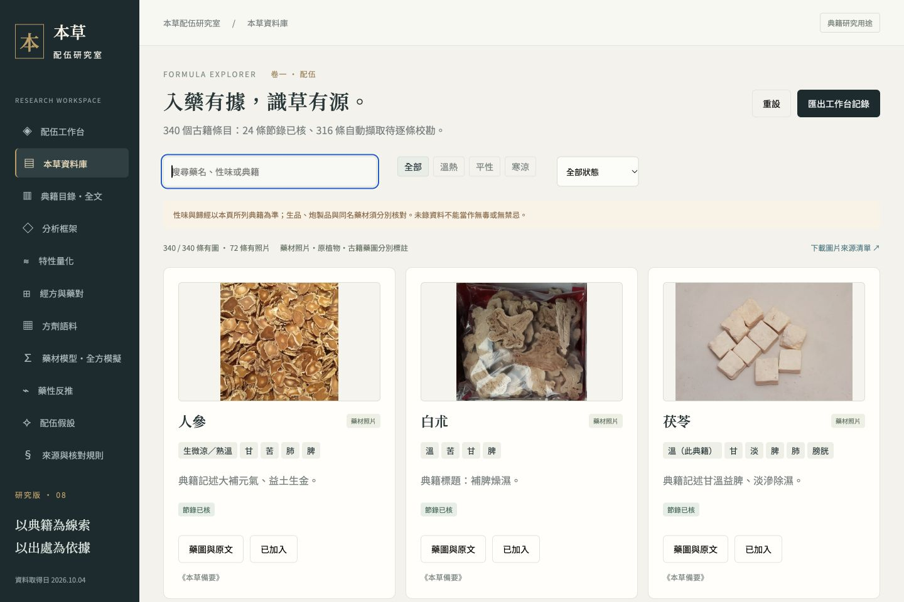

# 本草配伍研究室 · Bencao Formula Lab

以中醫典籍為線索的本草、方劑與炮製文獻研究平台。支援查閱原文與藥圖、逐味記錄稱量與工序、查看 Three.js 操作台，以及可重現的文字特徵量化和方劑模擬。



## 已收錄內容

- 340 個本草條目：24 條節錄已核，316 條為自動擷取待逐條校勘。
- 全部本草條目有參考圖；72 個條目有照片，其他主要採古籍藥圖。圖片清楚區分藥材、藥用部位、來源植物與食品參考，保留逐幅來源、作者、授權和加工狀態限制。
- 18 首經典方劑的研究模板，以及 284 筆自動擷取的方劑文本記錄、396 種原名文字元素。
- 1,362 個可追溯的書目／來源版本條目；其中 14 個來源版本保留完整單頁轉錄。
- 炮製分支與原文證據；稱量階段、實錄克數、批次及操作記錄；動態 3D 工序操作台。
- 來源文字向量、固定詞典與加成模型，以及按方族／來源書隔離的組外驗證報告。

數量描述本次封存資料，並非全部歷史中醫典籍、人工標準答案或現代藥材身份認證。模型估計文獻標籤的關聯；不推定人體藥效、因果協同、毒性、用藥安全或臨床劑量。克數是研究者實錄，古代量制與研究份數不自動換算成克。

## 本地啟動

這是沒有前端建置步驟的靜態網站，所有網頁依賴和圖片都已放在 `dist/`。只需 Python 3：

```sh
git clone https://github.com/AsherEthan/bencao-formula-lab.git
cd bencao-formula-lab
python3 -m http.server 8000 --bind 127.0.0.1 --directory dist
```

開啟 <http://127.0.0.1:8000/>。也可將 `dist/` 交給一般靜態網站服務。瀏覽器的 3D 工作台需要 WebGL；原料與工序清單保留相同的文字操作入口。

## 資料和模型驗證

使用 Node.js 20 或以上版本、Python 3。圖片驗證另需 Pillow：

```sh
python3 -m pip install -r requirements-images.txt
node tools/check-project.mjs
```

此命令檢查來源字位、模型、炮製資料、方劑語料、工序及場景生命週期，並核對 587 個本地圖片檔案、來源索引、雜湊和尺寸。它驗證封存資料與實作的一致性；不能證明轉錄、物種身份或臨床效果。

從封存輸入離線重建衍生資料：

```sh
python3 tools/build-research-assets.py
node tools/check-project.mjs
```

重建會實際重新訓練文字關聯模型，更新 `dist/` 中的 JSON、CSV 和研究 ZIP。若只驗證既有報告，可用 `node tools/build-herb-vector-report.cjs --verify`。來源重新取得與人工校勘另計，詳見 [工具說明](tools/README.txt)。圖片目錄與實體圖檔保留封存版本；資料重建不重新搜尋或生成圖片。

## 目錄

| 目錄 | 內容 |
| --- | --- |
| `dist/` | 可直接部署的完整介面、模型和靜態資料 |
| `dist/assets/herbs/` | 本草照片、古籍格圖與完整來源圖版 |
| `dist/downloads/` | 公開 JSON、CSV、方法與驗證報告 |
| `research/` | 可重建的封存輸入、來源快照和證據定位 |
| `checks/` | 模型與工作台檢查 |
| `tools/` | 收集、重建、搜尋和驗證工具 |
| `review/` | 檢查紀錄和實際介面截圖 |

## 授權與貢獻

原創程式碼採 [MIT](LICENSE)。原創研究資料、圖說與衍生文字採 [CC BY-SA 4.0](DATA-LICENSE.md)；原始古籍、公有領域材料、第三方轉錄及圖片保留各自授權，不能一律視為 MIT。詳見 [第三方聲明](THIRD_PARTY_NOTICES.md) 與 [逐幅圖片來源清單](dist/downloads/herb-image-catalog.json)。

歡迎提交來源校勘、藥名對應研究、可展示的藥材照片和功能改善。新增資料請保留版本、原文、字位、取得方式、授權及不確定性，見 [貢獻說明](CONTRIBUTING.md)。
